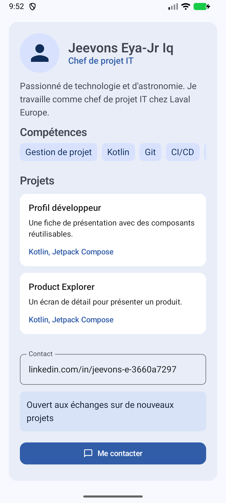
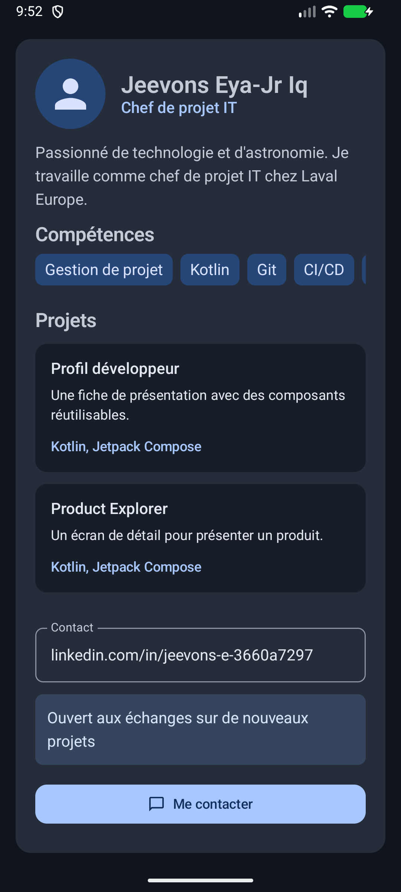

# Profil développeur Compose

## Description

Cette appli Android affiche une fiche "Profil développeur" faite avec Jetpack Compose.
On y voit un nom, un rôle, une petite description, une liste de compétences, un contact et une disponibilité.
Il y a un bouton "Me contacter" et une zone cliquable pour la disponibilité.
Les clics ne changent rien à l'écran pour l'instant, ils appellent juste un callback vide.
Deux previews montrent deux profils différents avec le même code.

## Notions utilisées

- fonctions composables (`@Composable`)
- paramètres
- `Modifier` et chaînage de modifiers
- padding externe / padding interne
- callbacks (`onClick`)
- `Scaffold` et `innerPadding`
- previews (`@Preview`)
- accessibilité de base (`Role.Button`, `contentDescription`)

## Explication

**1. Quels composables avez-vous créés ?**
`EcranProfil`, `FicheProfil`, `EnTeteProfil`, `Competence`, `InfoSecondaire`, `ZoneDisponibilite` et `BoutonAction` (plus les deux previews).

**2. Quel composable représente l'écran principal ?**
`EcranProfil`. C'est lui qui est appelé dans `setContent` depuis `MainActivity`.

**3. Où utilisez-vous un padding externe ?**
Dans `EcranProfil` : il donne `.padding(16.dp)` à `FicheProfil` pour l'écarter des bords de l'écran. C'est le parent qui décide où se place la fiche. Pareil quand `FicheProfil` met un `padding(top = ...)` sur `Competence`, `InfoSecondaire` ou `BoutonAction` pour les espacer entre eux.

**4. Où utilisez-vous un padding interne ?**
Dans `FicheProfil`, la `Column` a un `padding(20.dp)` pour que le texte ne colle pas au bord de la fiche. Dans `Competence` et `ZoneDisponibilite`, le `Text` a aussi un padding à l'intérieur de la `Surface`.

**5. Quel composant reçoit un callback ?**
`BoutonAction` et `ZoneDisponibilite` reçoivent un `onClick`. `FicheProfil` reçoit `onContacterClick` et `onDisponibiliteClick` et les passe plus bas. Les composants signalent juste le clic, c'est `EcranProfil` qui décide quoi faire (pour l'instant rien).

**6. Quelle information d'accessibilité avez-vous ajoutée ?**
`ZoneDisponibilite` est une `Surface` rendue cliquable à la main, donc j'ai ajouté `role = Role.Button` dans `clickable` et une `contentDescription` avec `semantics`. Comme ça un lecteur d'écran annonce que c'est un bouton et dit à quoi il sert. Pour `BoutonAction` je n'en ai pas eu besoin parce que `Button` est déjà reconnu comme un bouton.

**7. Pourquoi vos composants peuvent-ils être considérés comme réutilisables ?**
Ils prennent leurs données en paramètres au lieu d'avoir du texte écrit en dur, et ils acceptent tous un `modifier: Modifier = Modifier`. On peut donc afficher un autre profil sans toucher au code, ce que montrent les deux previews.

## Capture

## Lien du dépôt

https://github.com/Jeevons/profil-dev-compose

---

## Évolution : devoir d’amélioration UI

La présentation ci-dessus correspond au premier entraînement et est conservée pour garder une trace de cette version.
Les sections suivantes décrivent l’application après les améliorations de ce devoir.

### Description

Cette application Android présente une fiche de profil réalisée avec Jetpack Compose.
Elle affiche un avatar, un nom, un rôle, une description, des compétences, des projets et un contact.
Un bouton « Me contacter » et une zone de disponibilité sont cliquables. Leurs callbacks restent vides pour ce devoir.

Les données sont écrites directement dans le code Kotlin. Il n'y a pas d'API distante, de base de données ou de navigation entre plusieurs écrans.
Cette version reprend le premier entraînement dans un nouveau dépôt. L'ancien projet est conservé.

### Composants Compose utilisés

- `Text` : les titres, les descriptions et les informations du profil.
- `Image` : l'avatar placeholder chargé depuis une ressource locale.
- `Icon` : la bulle de discussion à côté du texte « Me contacter ».
- `Button` : l'action principale du profil.
- `Card` : les cartes des projets.
- `OutlinedTextField` : le contact, avec `readOnly = true` pour empêcher sa modification.
- `Surface` : le fond, la fiche, les compétences et la disponibilité.
- `Scaffold` : la structure de l'activité, avec `innerPadding` pour respecter les barres du système.

### Layouts utilisés

- `Column` organise la fiche et les informations des projets verticalement.
- `Row` place l'avatar à côté du nom et du rôle.
- `Box` centre l'image dans le fond rond de l'avatar.
- `Spacer` sépare l'avatar des textes et l'icône du texte du bouton.

Les `Modifier` servent à régler la taille et les espacements. Par exemple, la fiche a un padding externe de `16.dp` et un padding interne de `20.dp`.

### Listes et composants réutilisables

Les compétences sont affichées avec une `LazyRow`. La fonction `items(competences)` appelle le composable `Competence` pour chaque élément.
La liste défile horizontalement pour accéder aux compétences qui dépassent la largeur de l'écran.

Les projets sont stockés dans une `List<Projet>`. La classe `Projet` contient un titre, une description et les technologies utilisées.
Une boucle `for` appelle `CarteProjet` pour chaque projet. Le même composable peut donc afficher plusieurs projets en recevant des données différentes.

La `Column` de la fiche utilise `verticalScroll(rememberScrollState())` pour garder le contact et le bouton accessibles sur un petit écran.

### Choix de thème

L'application utilise Material Design 3 avec deux palettes bleues : une claire et une sombre.
`isSystemInDarkTheme()` permet de suivre le réglage du téléphone.

Les composants utilisent `MaterialTheme.colorScheme`. Par exemple, les compétences utilisent `primaryContainer` pour leur fond et `onPrimaryContainer` pour leur texte.
La disponibilité utilise `secondaryContainer` et `onSecondaryContainer`, ce qui évite de garder un fond vert fixe en mode sombre.

`MaterialTheme.typography` distingue le nom, les titres des sections et le texte courant.
`MaterialTheme.shapes` définit des arrondis communs de `8.dp`, `12.dp` et `16.dp`.

### Previews et lancement

Deux previews sont présentes dans `MainActivity.kt` :

- `ProfilChefDeProjetPreview` : mon profil en thème clair.
- `ProfilFullStackPreview` : un profil fictif en thème sombre.

Pour ouvrir le projet, sélectionner son dossier racine dans Android Studio, attendre la synchronisation Gradle, puis lancer l'application sur un émulateur ou un téléphone.
Pour voir les previews, ouvrir `MainActivity.kt` en mode Split et utiliser Build & Refresh.
Si le bouton est sous la zone visible, faire défiler l'application ou utiliser le mode interactif de la preview.

### Captures d'écran

Les captures suivantes montrent le même profil dans les deux thèmes, sur un émulateur Android.

### Quelles notions du chapitre Compose UI ont été réutilisées ?

Les notions réutilisées sont les composables avec paramètres, les callbacks, les modifiers, les layouts, les listes modernes et les composants Material Design 3.
Les données sont transmises aux composants réutilisables, comme `Competence` et `CarteProjet`. Les previews permettent de vérifier deux profils et les thèmes clair et sombre.

### Dépôts

- [Dépôt de cette version](https://github.com/Jeevons/profil-dev-compose-ui)
- [Premier entraînement conservé](https://github.com/Jeevons/profil-dev-compose)
